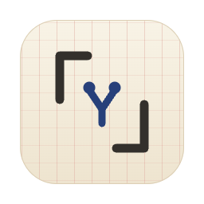
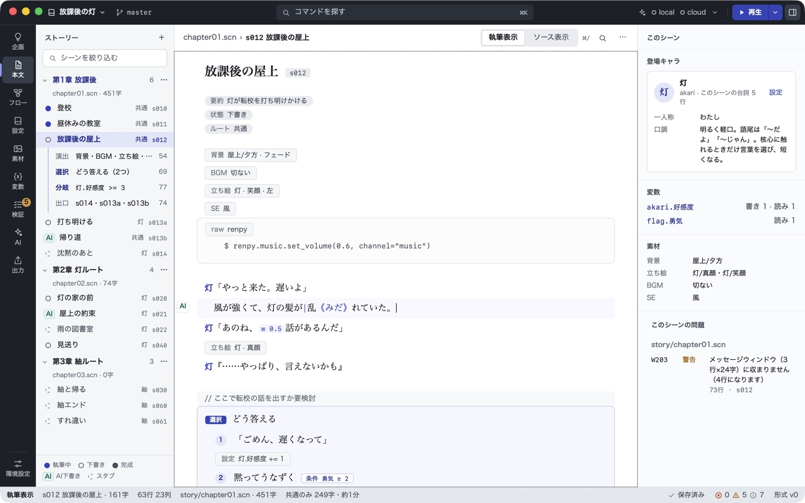
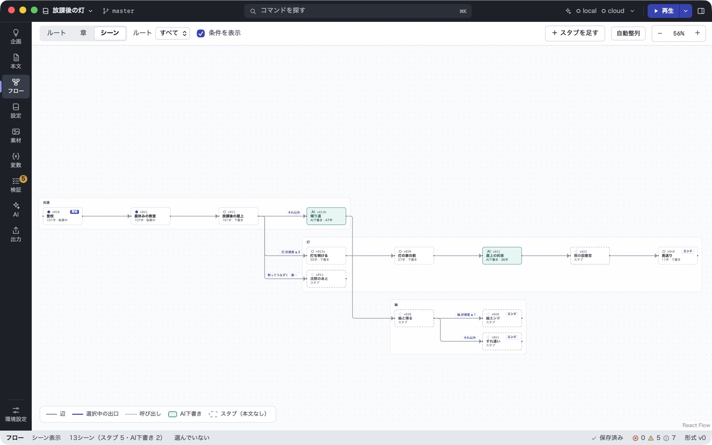
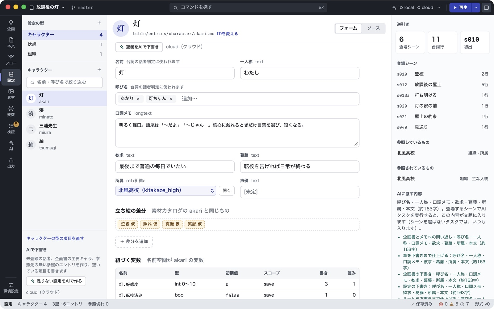
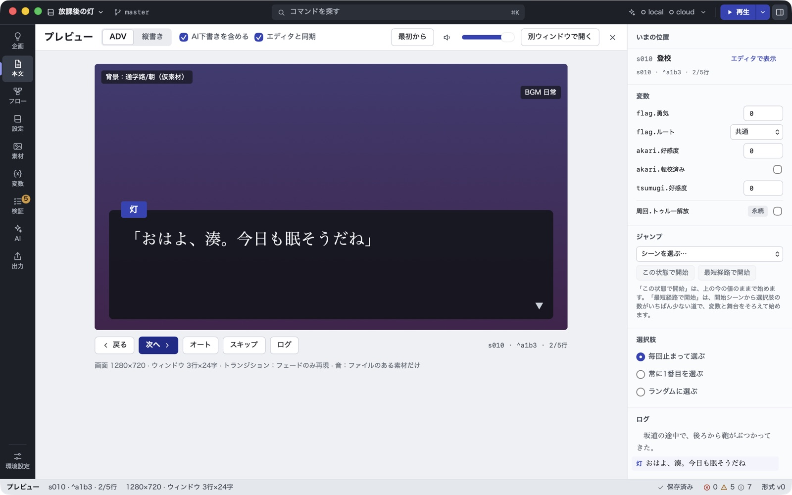
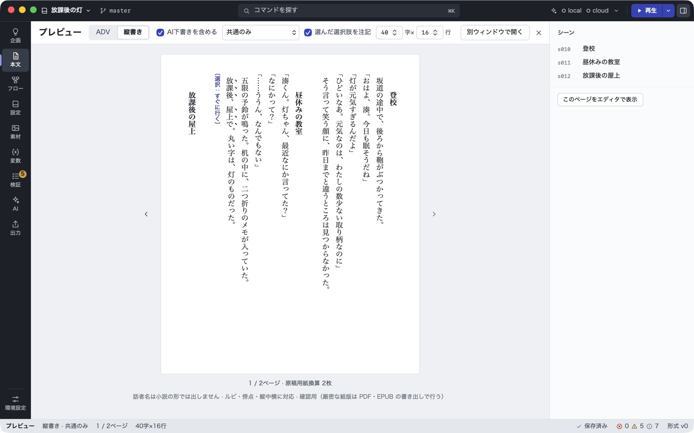
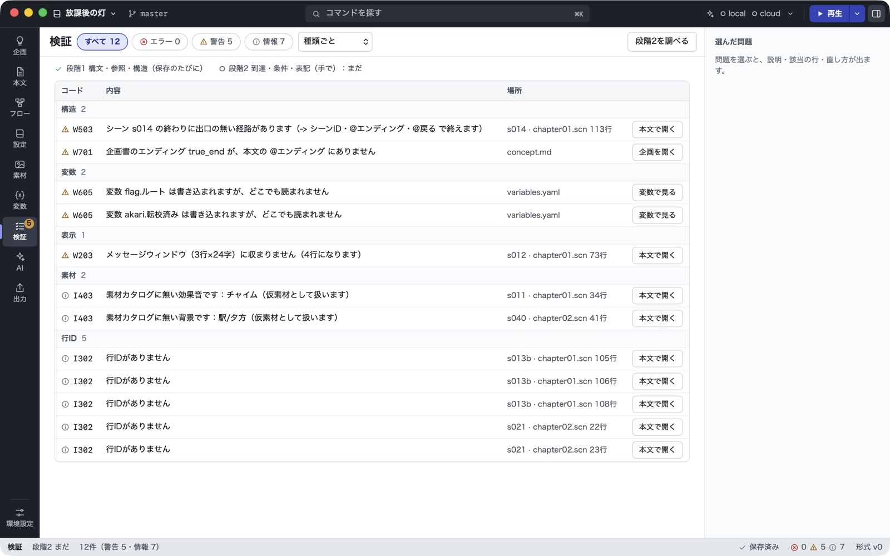

#  scn-studio（仮称）

[](https://github.com/zredjet/scn-studio/actions/workflows/ci.yml)
[](LICENSE)

分岐する物語（ADV・ビジュアルノベル）のための執筆ツール。シナリオを独自のテキスト形式 `.scn` で書き、設定DB・フロー図・プレビュー・検証・書き出し・AI の支援を、同じテキストから導く。Tauri 製のデスクトップアプリ（Windows・macOS）と、同じコアを使うコマンド `scn`・言語サーバー・VS Code 拡張からなる。

> **English summary** — scn-studio is a desktop writing tool for branching visual-novel (ADV) scenarios. You write in a plain-text format (`.scn`), and the app derives everything else from that text: a flow graph, a character/setting database, an ADV-style and vertical-text preview, validation, and exports to Ren'Py, TyranoScript, Utage, EPUB, and voice-recording scripts. Optional AI assistance works with local LLMs (OpenAI-compatible) or Claude, and AI never overwrites human-written lines. The UI and documentation are in Japanese.



> [!NOTE]
> 開発中（版 0.1.0。名前は仮）。配布用のインストーラはまだ無く、ソースから作って使う。Windows はCIで検査しているが、アプリと日本語入力の実機での確認はまだ済んでいない。

## 特長

- **テキストが正**：フロー図・一覧・プレビューは、すべて `.scn` などのテキストから導く。アプリ独自のデータベースは持たないので、Git・外部のエディタ・grep・AI エージェントがそのまま使える。
- **壊れたまま書ける**：1行の誤りで残りの解析を止めない。未定義の参照や未作成の素材は警告にとどめる。
- **行IDで追える**：台詞や地の文の行末に付く行ID（`^k3f9`）は、編集・移動で変わらない。ボイスの収録台本、AI が書いた行の記録などが行IDで行を指す。
- **演出は意味の名前で書く**：`@背景 屋上/夕方` のように書き、ファイルのパスやゲームエンジンの命令は書き出すときに決める。同じ原稿から複数のエンジンへ書き出せる。
- **書く画面**：記号を隠して読みやすくする「執筆表示」とテキストそのままの「ソース表示」、補完、検索と置換、名前の変更（F2）、集中モード、日本語入力に配慮したエディタ（CodeMirror 6）。
- **構造を見る**：シーン・章・ルートのフロー図。図からスタブや分岐を足すと、本文に書き足される。
- **設定DB**：キャラクター・場所・伏線などを型付きのフォームで管理し、本文での登場箇所を逆引きできる。変数の宣言と読み書きの一覧もある。
- **検証**：行き止まり、到達できないシーン、メッセージウィンドウのはみ出し、変数の読み書き、伏線。選択肢の組み合わせを自動で巡回して、選べない選択肢や着かないエンディングも探す。表記ゆれも調べる。
- **プレビュー**：簡易のADV表示（変数・ジャンプ・選択肢・ログを見ながら）と、縦書きの通読。カーソル位置から再生（F5）できる。
- **書き出し**：収録の台本（CSV・Excel 形式。再収録の候補つき）、素材の発注リスト、通読用のテキスト、Ren'Py、ティラノスクリプト、宴、EPUB、縦書きPDF用の印刷用HTML。テンプレートや外部コマンドで自分の形式も足せる。
- **AI は共作者**：ローカルの LLM（LM Studio・Ollama などの OpenAI 互換）か Claude（API キー、またはログイン済みの Claude Code）につなぐ。人が書いた行は直接書き換えず、差分の提案として出す。クラウドへ送る前に中身を見せ、AI が書いた行と項目は出自として記録する。使わなくてもすべての機能が使える。
- **コマンドとエディタ連携**：`scn` コマンド（検証・整形・書き出し・構造の一覧）、言語サーバー（`scn lsp`）、VS Code 拡張。

## 画面

| フロー図 | 設定DB |
| --- | --- |
|  |  |
| **プレビュー（ADV）** | **プレビュー（縦書き）** |
|  |  |

検証の画面：



画面はサンプル作品「放課後の灯」（[`samples/houkago/`](samples/houkago/)）。

## `.scn` の例

```text
# 第1章 放課後

## 昼休みの教室 #s011
---
summary: 紬が灯の様子を気にしている。主人公は放課後の屋上に呼び出される
status: writing
route: 共通
---
@背景 教室/昼
@立ち絵 紬 真顔 右

紬「湊くん。灯ちゃん、最近なにか言ってた？」 ^a1c1
湊「なにかって？」 ^a1c2
　五限の予鈴が鳴った。机の中に、二つ折りのメモが入っていた。 ^a1c4

@選択 屋上へ行くか ^a1c6
- すぐに行く ^a1c7
  @設定 灯.好感度 += 2
- 少し迷ってから行く ^a1c8
  @設定 灯.好感度 += 1
@end

-> s012
```

- `#` は章、`##` はシーン（`#s011` がシーンID）。`---` の間はシーンのメタ情報。
- `@` で始まる行は演出や制御（背景、立ち絵、選択肢、変数の設定、条件分岐など）。`-> s012` はジャンプ。
- `名前「…」` は台詞（名前は設定DBのキャラクターで確かめる）。全角空白で始まる行などは地の文。
- 行末の `^a1c1` は行ID。保存したときにツールが付ける（自分で書かなくてよい）。

文法のすべては [`docs/spec/scn-format-v0.md`](docs/spec/scn-format-v0.md)、作品フォルダの構成は [`docs/spec/project-files.md`](docs/spec/project-files.md) にある。

## 動作環境

- macOS と Windows（Linux は対象外）。開発と確認は主に macOS で行っている。
- 書体は同梱しない。OS に入っている明朝体とゴシック体を使う。

## ソースから動かす

### 要るもの

- [Rust](https://rustup.rs/)（rustup で入れる。版は `rust-toolchain.toml` で固定していて、初めてビルドするときに自動で入る）
- [Node.js](https://nodejs.org/) 24 と pnpm 12（`package.json` の `packageManager` の版。`corepack enable` で入る）
- Tauri の OS ごとの前提（macOS は Xcode の Command Line Tools、Windows は Microsoft C++ Build Tools と WebView2）。[Tauri の案内](https://v2.tauri.app/start/prerequisites/)を参照

### アプリ

```bash
pnpm install
```

```bash
pnpm -C app tauri dev
```

開発用のビルドは、起動するとサンプル作品 `samples/houkago` を開く。別の作品フォルダを開くには、環境変数 `SCN_DEV_PROJECT` にパスを入れて起動するか、アプリの「作品フォルダを開く」（⌘O・Ctrl+O）を使う。

配布用のビルド（署名なし）は次のコマンドで作る。できたものは `target/release/bundle/` に置かれる。

```bash
pnpm -C app tauri build
```

使い方は [アプリの使い方](docs/guide/app.md) にある。

### コマンド `scn`

```bash
cargo install --locked --path crates/scn-cli
```

```bash
scn new my-story --title "作品名"
```

```bash
scn check my-story --stage 2
```

```bash
scn export renpy my-story
```

`scn new` は作品フォルダのひな形（`project.toml`、スタブの章、設定DBの型、AI エージェント向けの `CLAUDE.md`、形式の説明 `FORMAT.md` など）を作る。コマンドの一覧と使い方は [`docs/guide/scn.md`](docs/guide/scn.md) にある。

### VS Code 拡張

ハイライトと言語サーバー（診断・補完・定義へ移動・名前の変更）を使う拡張。作り方と入れ方は [`packages/vscode-scn/README.md`](packages/vscode-scn/README.md) にある（マーケットプレイスには出していない）。

## AI を使う

AI は使わなくてもよい。使うときは、作品フォルダの `project.toml` に接続先を書く（キーは書かない）。

```toml
[ai.local]                          # ローカルの LLM（OpenAI 互換。LM Studio・Ollama・llama.cpp など）
base_url = "http://localhost:1234/v1"
model = "qwen3-8b"

[ai.cloud]                          # Claude（Messages API）
provider = "anthropic"
model = "claude-sonnet-5-5"
```

- キーと、この端末での上書き（文脈の長さ、返す分の上限、考える量など）は、アプリの「環境設定 → AIの接続」で決める。キーは OS のキーチェーンに置く。
- Claude は、API キーの代わりに、ログイン済みの Claude Code（CLI）で呼ぶこともできる。
- クラウドの接続先は、端末ごとに送ることを許可するまで送らない。送る前に、送る中身を見せて確かめる。
- AI のタスク（口調・設定の矛盾・表記の点検、言い換え、スタブの下書き、ルートの骨格、企画書と設定の下書き、アイデアのネタ出しなど）は、作品フォルダの `ai/*.yaml` で定義していて、直したり足したりできる。

詳しくは [アプリの使い方の「AI」](docs/guide/app.md#ai) と、[`docs/spec/project-files.md`](docs/spec/project-files.md) の2節と9節にある。

## ドキュメント

| 文書 | 内容 |
| --- | --- |
| [`docs/guide/app.md`](docs/guide/app.md) | アプリの使い方（画面ごとの操作、AI、キーの一覧） |
| [`docs/guide/scn.md`](docs/guide/scn.md) | `scn` コマンドの使い方（`scn new` が作品フォルダに `SCN.md` として置く） |
| [`docs/spec/scn-format-v0.md`](docs/spec/scn-format-v0.md) | `.scn` の文法と意味、診断コード |
| [`docs/spec/project-files.md`](docs/spec/project-files.md) | 作品フォルダの規約（`project.toml`、変数、素材、設定DB、企画書、AI、出力プロファイル） |
| [`docs/design.md`](docs/design.md) | 設計検討書（全体設計） |
| [`docs/decisions.md`](docs/decisions.md) | 決定の記録（なぜそうしたか） |
| [`docs/glossary.md`](docs/glossary.md) | 用語集（日本語とコード上の名前） |
| [`docs/ui/`](docs/ui/) | 画面の構成、デザイントークン、画面の見本 |
| [`docs/plan/`](docs/plan/)・[`docs/progress.md`](docs/progress.md) | フェーズごとの計画と進捗の記録 |
| [`docs/review-for-human.md`](docs/review-for-human.md) | 人の判断と確認を待っていること |
| [`samples/houkago/`](samples/houkago/)・[`samples/amayadori/`](samples/amayadori/) | サンプル作品（テストの入力も兼ねる） |

## 開発

- まとめての検査：`scripts/check-all`（macOS）か `scripts\check-all.ps1`（Windows）。Rust の書式・clippy・テストと、フロントの Biome・型検査・テストを走らせる。GitHub Actions でも、macOS と Windows で同じものを走らせている。
- このリポジトリは [Claude Code](https://claude.com/claude-code) で開発している。作業の約束は [`CLAUDE.md`](CLAUDE.md) と `.claude/` にある。
- 開発への参加のしかたとリポジトリの構成は [`CONTRIBUTING.md`](CONTRIBUTING.md) にある。

## ライセンス

[MIT](LICENSE)。サンプル作品と画面の見本も含む。
